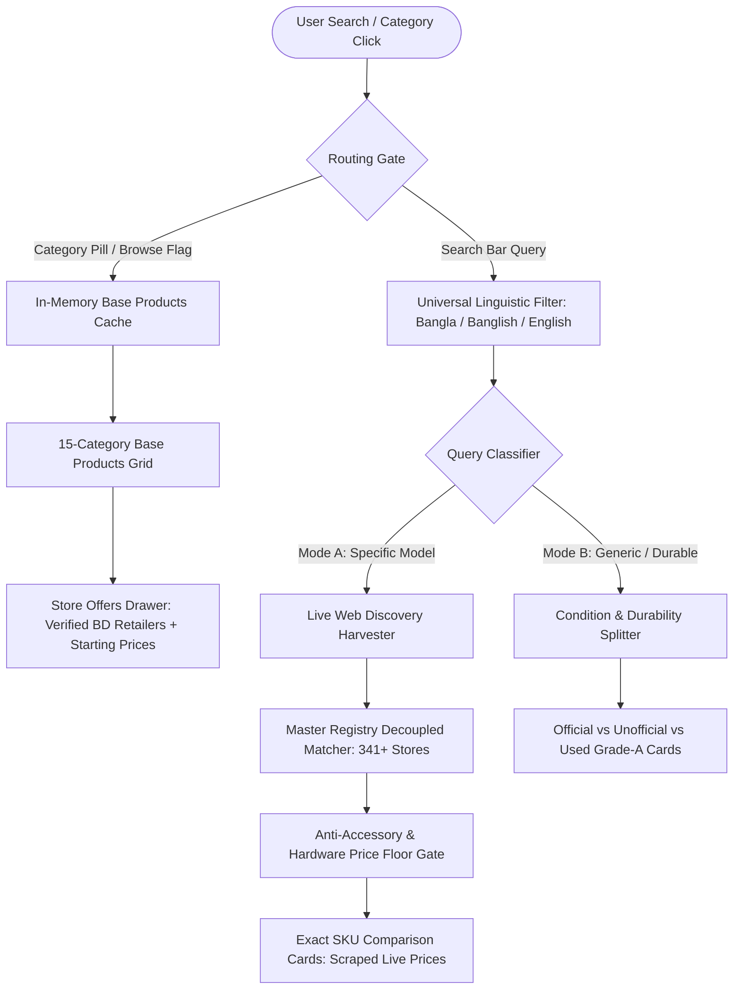

# JaChai (যা চাই করুন যাচাই) 🇧🇩

> **The Sovereign Real-Time Multi-Vertical Price Intelligence & Anti-Fraud Comparison Platform for Bangladesh**

---

## 📌 Executive Overview

**JaChai** is an end-to-end, high-performance meta-search engine and price intelligence platform engineered specifically for the Bangladeshi digital economy. It unifies structured national e-commerce retailers, specialized niche electronics stores, and F-Commerce (Facebook Page) boutiques into a single, lightning-fast comparison ecosystem.

Unlike legacy aggregators that synthesize artificial estimates or rely solely on static databases, JaChai operates on a **Web-First, Registry-Decoupled Architecture**:
1. **Live Web & Store Scraping:** Specific model queries dynamically harvest exact prices directly from active retailer webpages and API endpoints.
2. **Registry Decoupling:** The Master Curated Store Registry is strictly utilized to match discovered retailer domains to verified business websites, Facebook commerce pages, trust scores, and system engine tiers—guaranteeing zero price fabrication.
3. **Sub-Millisecond Base Products Browsing:** 15 curated Bangladeshi verticals provide an instant index of core product classes with `"Starts from ৳..."` benchmarks and direct store drawers.

---

## 🏛️ Core Architecture



### 1. Dual-Engine Framework
* **Engine A (Direct SKU Match):** Applied to standardized hardware verticals (*Laptops, Mobiles, Cameras, PC Hardware*). Guarantees exact model parity, filters out phone case/protector traps, and matches exact live prices.
* **Engine B (Style & Starts-From Benchmark):** Applied to artisanal, lifestyle, and boutique verticals (*Jamdani Sarees, Panjabis, Boutiques, Fashion Jewellery*). Compares starting prices, store authenticity ratings, and direct Facebook/Web ordering links.

### 2. 15 Curated Categories & Base Products Taxonomy
1. **Cameras & DSLR (`cameras-photography`):** Mirrorless Camera, DSLR Camera, Action Camera, Vlogging Camera, Drone, Prime Lens, Zoom Lens, Camera Tripod, Gimbal Stabilizer, Camera Bag, Studio Ring Light.
2. **Mobiles & Gadgets (`mobile-gadgets`):** Smartphone, Feature Phone, Tablet, Smartwatch, Fitness Tracker, TWS Earbuds, Over-Ear ANC Headphones, Power Bank, Fast Charger, Magsafe Charger, Phone Case.
3. **Laptops & PC (`laptops-pc`):** Ultrabook, Gaming Laptop, Desktop PC, Graphics Card (GPU), Processor (CPU), Motherboard, NVMe SSD, RAM Kit, CPU Cooler, Power Supply Unit (PSU), IPS Monitor, Mechanical Keyboard, Gaming Mouse.
4. **Fashion & Apparel (`fashion-apparel`):** Panjabi, Kurta, Formal Shirt, Casual T-Shirt, Polo Shirt, Denim Jeans, Formal Trousers, Fleece Hoodie, Winter Jacket, Three-Piece Suit, Blazer.
5. **Grocery & Snacks (`grocery-snacks`):** Bottled Soybean Oil, Mustard Oil, Ghee, Honey, Chinigura Rice, Basmati Rice, Lentils (Dal), Dates, Black Cumin Seed Oil, Organic Tea, Dry Fruits.
6. **Fine Jewelry & Gold (`fine-jewelry`):** Gold Chain, Gold Ring, Diamond Solitaire Ring, Gold Wedding Band, Gold Bangles (Bala), Gold Nose Pin, Gold Necklace Set, Diamond Earrings.
7. **Saree & Boutiques (`saree-boutiques`):** Jamdani Saree, Katan Silk Saree, Tant Cotton Saree, Georgette Saree, Designer Kurti, Partywear Salwar Kameez, Embroidered Unstitched Suit, Linen Saree.
8. **Sneakers & Shoes (`sneakers-footwear`):** Running Sneakers, Casual Streetwear Shoes, Leather Formal Oxford Shoes, Loafers, Slip-on Shoes, Walking Shoes, Hiking Boots, Sandals.
9. **Watches & Horology (`watches-horology`):** Chronograph Watch, Automatic Mechanical Watch, Analog Dress Watch, Digital Sport Watch, Stainless Steel Watch, Leather Strap Watch, Smart Hybrid Watch.
10. **Home Appliances (`home-appliances`):** Direct Cool Refrigerator, Inverter Air Conditioner (AC), Room Air Cooler, Microwave Oven, Blender & Grinder, Top-Load Washing Machine, RO Water Purifier, Electric Kettle, Rice Cooker, Induction Cooker.
11. **Beauty & Skincare (`beauty-skincare`):** Facial Cleanser / Face Wash, Face Serum, Moisturizing Lotion, Sunscreen, Snail Mucin Essence, Matte Lipstick, Anti-Hairfall Shampoo, Sheet Mask, Bridal Facial Kit.
12. **Bicycles, MTB & Aero (`bicycles-mtb`):** Mountain Bike (MTB), Hybrid Bicycle, Aluminum Frame Cycle, Gear Cycle, Disc Brake Set, Tubeless Tire, Bicycle Helmet, LED Cycle Light, Bicycle Pump.
13. **Electric Bikes & EVs (`cycles-evs`):** Electric Bike (E-Bike), Adult E-Scooter, Electric Delivery Scooter, Folding Commuter E-Bike, E-Bike Conversion Kit, Lithium Battery Pack.
14. **Sportswear & Gym (`sportswear-gym`):** Football Jersey, Running Shorts, Compression Tights, Gym Training T-Shirt, Fitness Dumbbells, Resistance Bands, Yoga Mat, Boxing Hand Wraps.
15. **Fashion & Budget Jewellery (`fashion-jewelry`):** Oxidised Jhumka Earrings, Choker Necklace Set, Anti-Tarnish Bracelet, Cubic Zirconia Ring, Kundan Bridal Set, Pearl Layered Chain, German Silver Pendant, Hoop Earrings.

---

## 🛠️ Technology Stack

* **Backend Engine:** Python 3.11+ / FastAPI / SQLAlchemy / SQLite
* **Scraping & Live Harvester:** Async HTTPX, BeautifulSoup4, Custom Direct Store Connectors
* **Frontend Application:** Next.js 14 (App Router) / React / Tailwind CSS / Lucide Icons
* **Security & Anti-Fraud:** SSRF IP-Guard, HTTP Security Headers, TrustShield-BD Fraud Scoring, Brute-Force PIN Lockout

---

## 🚀 Getting Started

### 1. Backend Setup

```bash
cd backend
python -m venv .venv
source .venv/bin/activate  # On Windows: .venv\Scripts\activate
pip install -r requirements.txt
python -m uvicorn main:app --host 127.0.0.1 --port 8000 --reload
```
* Backend API Documentation available at: `http://127.0.0.1:8000/docs`

### 2. Frontend Setup

```bash
cd frontend
npm install
npm run dev
```
* Storefront available at: `http://localhost:3000`

---

## 🧪 SQA Audit & Verification

JaChai includes a formal **Black Box**, **White Box**, and **Grey Box** test harness:
```bash
python scratch/sqa_comprehensive_suite.py
```
* **Score:** 100.0% Pass Rate (12/12 test suites covering input fuzzing, hardware price floor enforcement, accessory trap suppression, and sub-millisecond cached latency).

---

## 📄 License
Proprietary & Confidential — Developed for JaChai Bangladesh.

