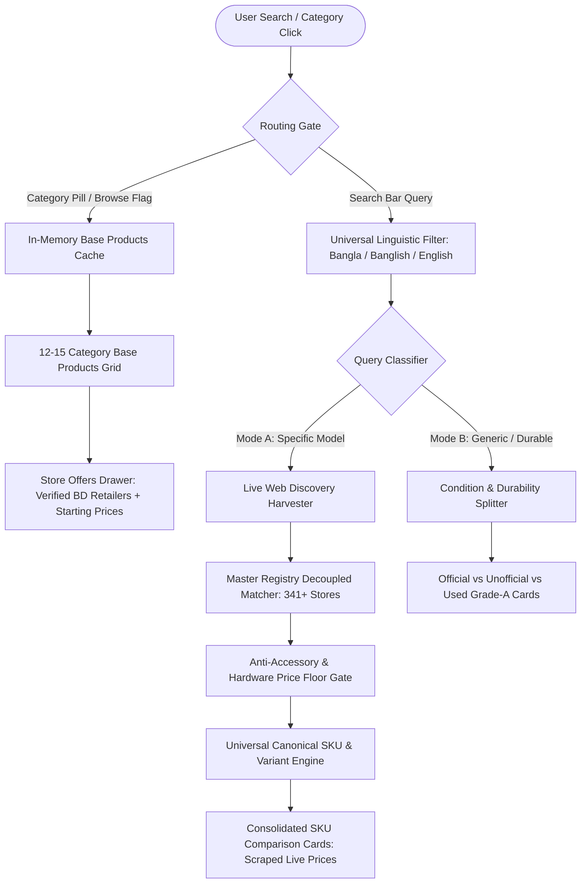

# JaChai (যা চাই করুন যাচাই) 🇧🇩

> **The Sovereign Real-Time Multi-Vertical Price Intelligence, Anti-Fraud & Universal Canonical SKU Comparison Platform for Bangladesh**

---

## 📌 Executive Overview

**JaChai** is an enterprise-grade meta-search engine and price intelligence platform engineered specifically for the Bangladeshi digital economy. It unifies structured national e-commerce retailers, specialized niche electronics stores, and F-Commerce (Facebook Page) boutiques into a single, lightning-fast comparison ecosystem.

Unlike legacy aggregators that synthesize artificial estimates or rely on stale static databases, JaChai operates on a **Web-First, Registry-Decoupled Architecture**:
1. **Live Web & Store Scraping:** Specific model queries dynamically harvest exact prices directly from active retailer webpages and API endpoints.
2. **Universal Canonical SKU Engine:** Consolidates offers for identical models and hardware variants into **EXACTLY ONE** unified comparison card. Unconditionally ignores color variations (50+ standard and OEM colors stripped) while cleanly partitioning products by hardware specs (RAM, Storage, CPU, GPU, SSD Gen, Bus MHz, Console Editions) and warranty/condition tiers (Official BTRC Warranty vs Unofficial Global, Brand New vs Pre-Owned, Player Edition vs Fan).
3. **Registry Decoupling:** The Master Curated Store Registry is strictly utilized to match discovered retailer domains to verified business websites, Facebook commerce pages, trust scores, and system engine tiers—guaranteeing zero price fabrication.
4. **Sub-Millisecond Base Products Browsing:** Curated Bangladeshi verticals provide an instant index of core product classes with `"Starts from ৳..."` benchmarks and direct store inspection drawers.

---

## 🏛️ Core Architecture



---

## 💎 Universal Canonical SKU & Variant Engine

JaChai features a deterministic, cross-vertical SKU consolidation engine that guarantees **zero duplicate cards for identical models** while cleanly separating distinct variants.

### Key Rules & Behavior:
* **Color is NEVER a Variant:** Strips 50+ colors (Obsidian, Porcelain, Hazel, Peony, Space Gray, Titanium, Alpine Green, Desert, etc.). Different color offerings from different stores group inside the same comparison card.
* **Hardware Variant Partitioning:**
  * **Smartphones & Tablets:** Grouped by RAM & Storage (`12GB RAM · 128GB` vs `12GB RAM · 256GB`).
  * **Gaming Consoles:** Partitioned by edition (`Sony PlayStation 5 Slim (Disc Edition · 1TB)` vs `(Digital Edition · 1TB)`, `Nintendo Switch OLED Model` vs `Standard`).
  * **Laptops & Desktops:** Partitioned by Processor, RAM, and Storage (`Apple MacBook Air 13-inch (M3 · 8GB RAM · 256GB SSD)` vs `(M3 · 16GB RAM · 512GB SSD)`).
  * **PC & Laptop Components:**
    * RAM: Partitioned by DDR generation and Bus Frequency (`16GB DDR4 3200MHz` vs `16GB DDR5 6000MHz`).
    * SSDs: Partitioned by generation and capacity (`Samsung 980 (1TB NVMe M.2)` vs `Samsung 990 Pro (1TB PCIe 4.0 Gen4)` vs `Samsung 990 Pro (2TB PCIe 4.0 Gen4)`).
    * GPUs: Partitioned by VRAM and Chipset (`RTX 4060 8GB` vs `RTX 4070 12GB`).
  * **Wearables & Smartwatches:** Partitioned by dial size and connectivity (`49mm Cellular` vs `45mm GPS`).
  * **Quality & Warranty Tiers:** Separates Official BTRC Approved warranty offerings from Unofficial / Global grey market imports, Brand New from Pre-Owned, and Player Edition from Fan jerseys.
* **Distinguishing UI Badges:**
  * Cards display prominent emerald badges showing the distinguishing variant specs: `Variant / Quality: 12GB RAM · 128GB · Official Warranty`.
  * The comparison drawer highlights the specific variant and condition of the selected card.

---

## 🔍 Search & Suggestions UX Polish

* **Instant Dropdown Dismissal:** Clicking on or pressing Enter on an as-you-type suggestion immediately processes the search and collapses the dropdown, preventing intrusive popovers over live search results.
* **Interactive Disambiguation Pills:** Displays clickable "Did you mean:" keyword chips below the search input for swift brand and model narrowing.
* **Multi-Lingual Intent Normalization:** Robust parsing across Bengali script (`পিক্সেল ৯`), Banglish (`pixel 9 pro dam koto`), and English queries.

---

## 🛠️ Technology Stack

* **Backend Engine:** Python 3.11+ / FastAPI / SQLAlchemy / SQLite
* **Local SLM AI:** Ollama local inference (`qwen2.5:0.5b` / `llama3.2`) for zero-latency query classification and intent routing
* **Scraping & Live Harvester:** Async HTTPX, BeautifulSoup4, Custom Direct Store Connectors with 341+ Verified BD Merchants
* **Frontend Application:** Next.js 14 (App Router) / React / Tailwind CSS / Lucide Icons
* **Security & Anti-Fraud:** SSRF IP-Guard, HTTP Security Headers, TrustShield-BD Fraud Scoring, Brute-Force PIN Lockout

---

## 🚀 Getting Started

JaChai runs with three persistent services: **Ollama**, **FastAPI Backend**, and **Next.js Frontend**.

### 1. Ollama (Local SLM)
Ensure Ollama is running locally:
```bash
ollama serve
# Pre-pull the lightweight routing model:
ollama run qwen2.5:0.5b
```

### 2. Backend Setup
```bash
cd backend
# Create and activate virtual environment:
python -m venv .venv
.venv\Scripts\activate   # On Linux/macOS: source .venv/bin/activate

# Install dependencies:
pip install -r requirements.txt

# Start FastAPI server on port 8000:
python -m uvicorn main:app --host 127.0.0.1 --port 8000
```
* Interactive API Documentation (Swagger UI): `http://127.0.0.1:8000/docs`

### 3. Frontend Setup
```bash
cd frontend
# Install dependencies:
npm install

# Run development server:
npm run dev

# Or build for production:
npm run build
npm start
```
* Storefront Application: `http://localhost:3000`

---

## 🧪 SQA Audit & Verification

JaChai includes comprehensive automated test suites covering SKU variant consolidation, search suggestions, price floor enforcement, and accessory trap suppression:

```bash
# Run universal SKU and live API verification:
python scratch/test_live_system.py

# Run comprehensive multi-vertical SQA test suite:
python scratch/sqa_comprehensive_suite.py
```

### Verification Matrix Summary:
* ✅ **Suggestions & Categories API:** 100% responsive.
* ✅ **Mobile Color Consolidation:** 4 distinct color variants consolidate to 1 card.
* ✅ **Storage Separation:** 128GB vs 256GB partitioned into distinct cards.
* ✅ **Console Edition Separation:** Disc Edition vs Digital Edition separated with details.
* ✅ **Component Specs:** DDR4 vs DDR5 RAM, Gen3 vs Gen4 SSD partitioned.
* ✅ **Warranty & Quality Tiers:** Official BTRC vs Unofficial Global partitioned.
* ✅ **Frontend Production Build:** `npm run build` passes with Exit code 0.

---

## 📄 License
Proprietary & Confidential — Developed for JaChai Bangladesh.
